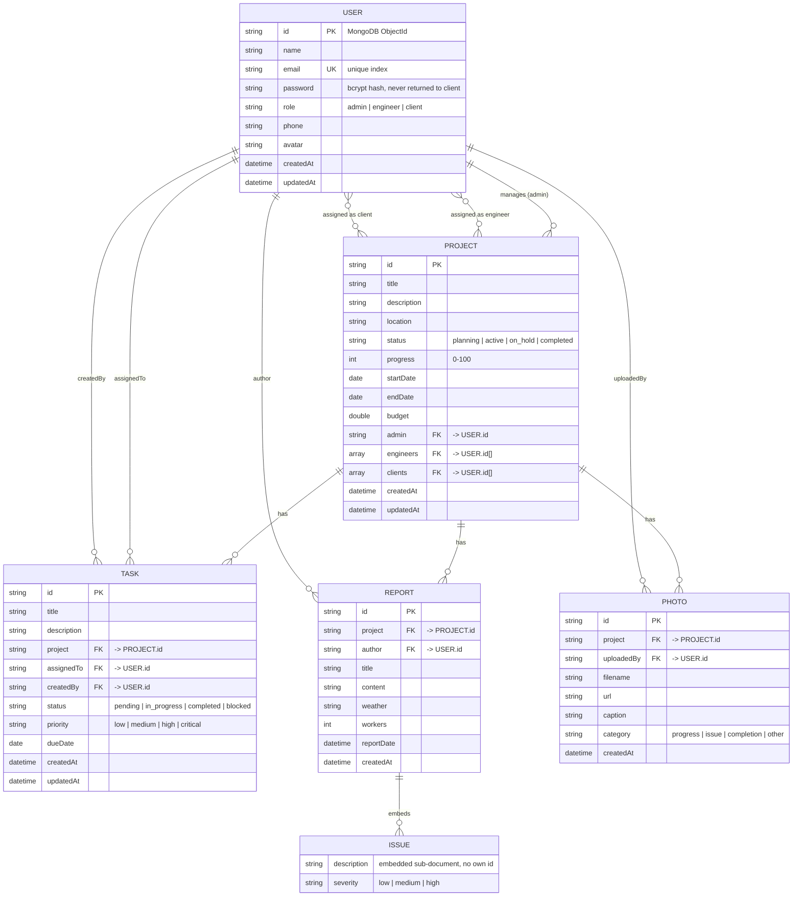

# Entity Relationship Diagram (ERD)

BuildTrack uses **MongoDB** (via Spring Data MongoDB), a document database, so
there are no foreign-key constraints enforced by the database engine itself.
References between documents (e.g. a Project's `admin` field) are modelled
the same way a relational foreign key would be — by storing the referenced
document's `id` — and the application layer (`*Service` classes) is what
"joins" them back together on read, the same role a relational database's
`JOIN` would normally play. This diagram documents those relationships,
each document's keys, and field data types.

## Notes on the design

- **Keys** — every document has a MongoDB-generated `id` (`ObjectId`,
  serialized as a string) as its primary key. `User.email` has a unique
  index (`@Indexed(unique = true)` in `User.java`) acting as a natural/
  alternate key, enforced at the database level so two accounts can never
  share an email.
- **Relationships** —
  - `Project.admin` is a **one-to-many** reference (one admin manages many
    projects).
  - `Project.engineers` / `Project.clients` are **many-to-many** references,
    modelled as arrays of `User` ids rather than a relational join table —
    the standard document-database pattern for a small, bounded list.
  - `Task`, `Report`, and `Photo` each belong to exactly one `Project`
    (**many-to-one**) and reference the `User`(s) who created/authored/
    uploaded them.
  - `Report.issues` is **embedded** (not referenced) — issues have no
    independent existence outside their report, so they're nested
    sub-documents rather than a separate collection, which is the
    appropriate MongoDB modelling choice here (embed when the child always
    belongs to exactly one parent and is always read together with it).
- **Data types** — see the table columns above; enums (`status`, `role`,
  `priority`, `category`) are validated application-side (see
  `*Service` classes under `backend/src/main/java/com/buildtrack/service/`)
  since MongoDB itself doesn't enforce a SQL-style `CHECK` constraint.

## Viewing this diagram

GitHub renders Mermaid code blocks like the one above automatically when
viewing this file in a repository. It also renders in VS Code with the
"Markdown Preview Mermaid Support" extension, or by pasting the code block
into https://mermaid.live.
